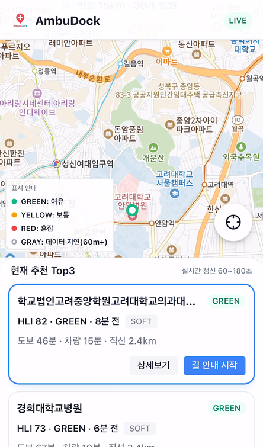
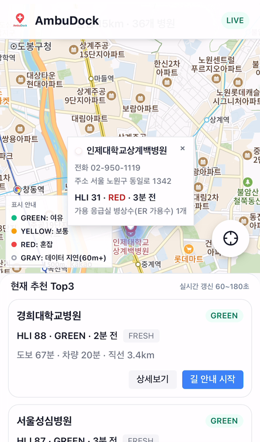
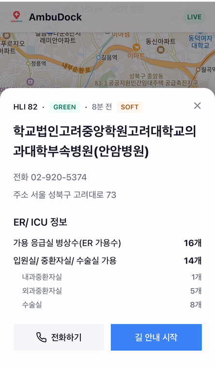
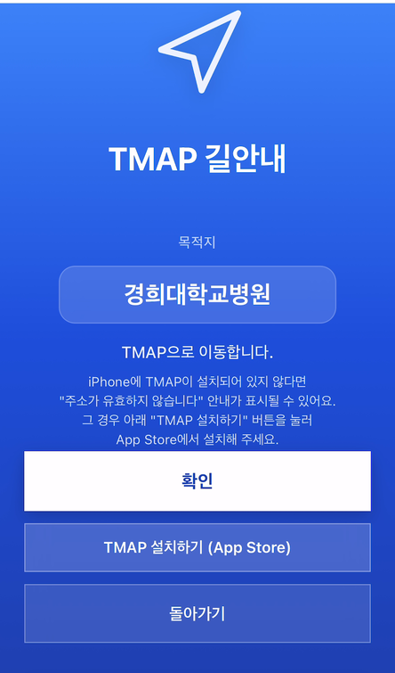
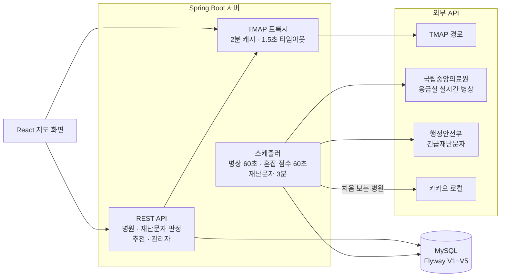

# AmbuDock

실시간 응급실 병상 정보에 재난문자와 이동 시간까지 따져, 지금 갈 만한 응급실을 골라 주는 모바일 웹 서비스

> 2025 민관협력 지원 플랫폼 활용 디지털 사회혁신 서비스 개발·아이디어 공모전 서비스 개발 부문 **은상** (오픈플랫폼얼라이언스상)<br>
> 개인 프로젝트 · 기획, 백엔드, 화면, 본선 발표 · 2025.10 ~ 11

## 소개

- 국립중앙의료원 응급실 병상 정보는 60초마다, 행정안전부 긴급재난문자는 3분마다 모아 병원마다 혼잡 등급을 매김
- 내 위치 반경 15km 안의 병원을 병상 혼잡도, 재난문자, TMAP 이동 시간으로 걸러 상위 세 곳을 카드로 보여 줌
- 기획서에 적은 원칙은 「공공은 판단의 근거, 민간은 실효성」. 갈 수 있는 병원은 병상과 재난문자 같은 공공데이터로 거르고, 몇 분 걸리는지는 민간 지도 API로 계산
- 수집 지역은 서울특별시 25개 구

## 화면

| 지도와 추천 Top3 | 병원 마커를 눌렀을 때 | 병원 상세 | TMAP 길안내 연결 |
| :---: | :---: | :---: | :---: |
|  |  |  |  |

본선 발표 때 쓴 시연 영상에서 가져온 장면. 「8분 전」 옆의 SOFT는 병상 정보가 들어온 지 5분이 넘었다는 표시이고, 이런 병원은 점수를 깎음

## 주요 기능

**실시간 병상 지도**

- 응급실 가용 병상 수로 병원마다 0~100점을 매기고 중환자실·수술실 여유로 보정. 70점 이상은 GREEN(여유), 40점 이상은 YELLOW(보통), 그 아래거나 응급실 가용 병상이 0이면 RED(혼잡)
- 병상 정보가 5분 넘게 지나면 15점 감점, 1시간이 넘으면 지도에서 회색(GRAY)으로 바꾸고 추천에서 뺌
- 처음 보는 병원은 카카오 로컬 API로 좌표와 행정구역을 찾아 자동 등록. 의료원의 병원명과 카카오의 장소명이 다른 곳은 별칭으로 맞춤

**재난문자 반영**

- 문자 내용을 DB에 둔 키워드 규칙(정규식)으로 BLOCK, WARN, IGNORE 중 하나로 판정. 해제·훈련·테스트 문자는 IGNORE
- 문자에 적힌 수신 지역을 행정구역과 연결해 그 지역 병원에 적용. BLOCK이면 추천에서 빼고, WARN이면 카드에 경고 배지만 붙임. 병원 점수에는 섞지 않음
- 심각도마다 유효 시간(BLOCK 4시간, WARN 2시간, IGNORE 1시간)을 두고, 지나면 더는 반영하지 않음

**길안내 연결**

- 카드의 「길 안내 시작」을 누르면 TMAP 앱으로 목적지를 넘김. 앱이 없으면 App Store나 Play 스토어로 안내하고, iOS와 Android 안내 문구를 따로 둠

**운영과 기록**

- 탐색 반경, 후보 수, 정보 유효 시간, 감점 같은 기준값은 DB 설정 테이블(app_config)에 두고, 관리자 API로 운영 중에도 바꿀 수 있게 함
- 추천할 때마다 요청 위치, 후보 수, 결과, 걸린 시간을 ranking_event에 기록

## 추천 순서

`POST /api/recommend/top`이 하는 일

1. 내 위치에서 가까운 병원을 최대 10곳 모음. 기본 반경은 15km이고, 반경 안 병원이 5곳보다 적으면 반경 밖에서 채움
2. 병상 정보가 1시간 넘게 지난 병원은 뺌 (5분이 넘은 병원은 혼잡 점수에서 이미 감점됨)
3. 재난문자 심각도가 BLOCK인 지역의 병원은 빼고, WARN이면 배지만 붙임
4. 남은 병원까지 차량·도보 이동 시간을 TMAP으로 계산. TMAP이 실패하거나 1.5초 안에 답하지 않으면 직선거리로 추정
5. 혼잡 등급, 점수, 재난문자 심각도, 차량 이동 시간, 이름 순으로 정렬해 상위 3곳을 돌려줌
6. 어떤 근거로 순위가 나왔는지 ranking_event에 남김

지도 화면은 같은 과정을 병원 목록, 재난문자 판정, TMAP 경로 API로 나눠 부르고 정렬은 화면에서 함. 위치가 100m 안쪽으로만 움직이면 다시 계산하지 않음

## 구조



- TMAP 요청은 모두 서버를 거치게 해서 지도 API 키가 브라우저에 드러나지 않게 함. 같은 출발지와 병원 조합은 2분 동안 Caffeine 캐시에서 꺼내 씀
- 병상 수집은 구 단위로 돌아서, 한 구의 호출이 실패해도 로그만 남기고 다음 구를 계속 받음
- 시각은 모두 UTC(Instant)로 저장
- 처음 설계할 때 그린 구조도 네 장(PlantUML)은 `backend/ambudock/src/main/resources/`에 있음

## 기술 스택

| 구분 | 사용 |
| --- | --- |
| 서버 | Java 21, Spring Boot 3.5, Spring Data JPA, Spring Security, WebClient, Caffeine, springdoc-openapi |
| DB | MySQL 8, Flyway |
| 화면 | React 19, TypeScript, Vite, Tailwind CSS, 카카오 지도 JavaScript SDK |
| 외부 API | 국립중앙의료원 응급의료기관 정보(공공데이터포털), 행정안전부 긴급재난문자(재난안전데이터공유플랫폼), 카카오 로컬, TMAP |

## API

| 메서드 | 경로 | 하는 일 |
| --- | --- | --- |
| GET | `/api/hospitals?center={위도},{경도}&radius_km=15` | 반경 안 병원과 혼잡 등급 |
| GET | `/api/hospitals/{hpid}` | 병원 상세 (응급실·중환자실·수술실 가용 병상) |
| POST | `/api/disasters/evaluate` | 병원 목록에 재난문자 심각도와 배지 적용 |
| POST | `/api/tmap/route` | 후보 병원까지 차량·도보 이동 시간 |
| POST | `/api/recommend/top` | 위 과정을 한 번에 거친 추천 |
| GET, PUT | `/api/admin/config?prefix=`, `/api/admin/config/{key}` | 운영 기준값 조회와 변경 (관리자 로그인 필요) |

서버를 띄우면 http://localhost:8080/swagger-ui.html 에서 요청과 응답 형식을 볼 수 있음

## 실행 방법

필요한 것: Java 21, MySQL 8, Node.js 20.19 이상, 아래 API 키

| 이름 | 받는 곳 | 쓰는 곳 |
| --- | --- | --- |
| `NMC_SERVICE_KEY` | 공공데이터포털 「국립중앙의료원_전국 응급의료기관 정보 조회 서비스」 | 응급실 병상 수집 |
| `MOIS_SERVICE_KEY` | 재난안전데이터공유플랫폼 「긴급재난문자」 | 재난문자 수집 |
| `KAKAO_REST_API_KEY` | 카카오 디벨로퍼스 앱의 REST API 키 | 처음 보는 병원의 좌표와 행정구역 찾기 |
| `TMAP_APP_KEY` | SK open API의 TMAP | 차량·도보 이동 시간 |
| `DB_PASSWORD` | 로컬 MySQL | DB 접속 (주소와 사용자는 기본값 localhost:3306/ambudock, root) |
| `ADMIN_PASSWORD` | 직접 정함 | 관리자 API 로그인 (아이디 기본값 admin) |
| `VITE_KAKAO_MAP_KEY` | 카카오 디벨로퍼스 앱의 JavaScript 키 | 지도 화면 (`frontend/.env.local`에 넣음) |

**1. DB 만들기**

```sql
CREATE DATABASE ambudock DEFAULT CHARACTER SET utf8mb4;
```

테이블과 기준값, 서울 행정구역, 재난문자 키워드는 서버를 처음 띄울 때 Flyway가 넣음

**2. 서버**

```bash
cd backend/ambudock
cp .env.example .env    # 키와 비밀번호 채우기. .env는 git에 올라가지 않음
./mvnw spring-boot:run
```

`.env` 대신 같은 이름의 환경변수로 넣어도 됨. 둘 다 있으면 환경변수가 우선

**3. 화면**

```bash
cd frontend
cp .env.example .env.local    # VITE_KAKAO_MAP_KEY 채우기
npm install
npm run dev
```

http://localhost:5173 을 열고 위치 권한을 허용하면 됨. `/api` 요청은 개발 서버가 localhost:8080으로 넘겨 줌. 휴대폰 브라우저는 HTTPS 주소에서만 위치 권한을 주기 때문에, 시연 때는 Cloudflare 임시 터널(`cloudflared tunnel --url http://localhost:5173`)로 주소를 열어 접속함

## 폴더 구조

```text
backend/ambudock/src/main
├── java/com/example/ambudock
│   ├── scheduler/    병상·재난문자 수집 스케줄러, 외부 API 클라이언트(NMC, MOIS, 카카오)
│   ├── service/      추천, 혼잡 점수, 재난문자 판정, 병원 자동 등록, TMAP 프록시
│   ├── controller/   REST API
│   ├── domain/       JPA 엔티티
│   └── config/       보안, 캐시, WebClient, OpenAPI
└── resources
    ├── db/migration/ Flyway (V1 스키마, V2 기준값, V3 서울 행정구역, V4·V5 재난문자 키워드)
    └── *.puml        설계 구조도
frontend/src
├── components/       지도, 마커, 추천 카드, 상세 시트, TMAP 연결 화면
├── hooks/            위치 추적
└── lib/              API 호출, TMAP 딥링크
```

## 개발하며 겪은 문제

과정은 [프로필의 AmbuDock 상세 문서](https://github.com/yongzooda/yongzooda/blob/main/projects/ambudock.md)에 정리함

- [응급실 공공데이터가 들어오지 않던 문제](https://github.com/yongzooda/yongzooda/blob/main/projects/ambudock.md#encoding): 같은 요청을 네 가지 방식으로 보내 비교해서, 한글 지역명이 두 번 인코딩되던 원인을 찾음
- [캐시를 붙였는데도 잦던 TMAP 호출](https://github.com/yongzooda/yongzooda/blob/main/projects/ambudock.md#cache): 후보 순서가 캐시 키에 그대로 들어가던 것을 병원 ID 정렬로 맞춤
